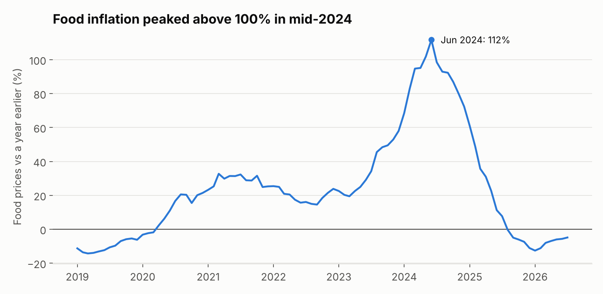
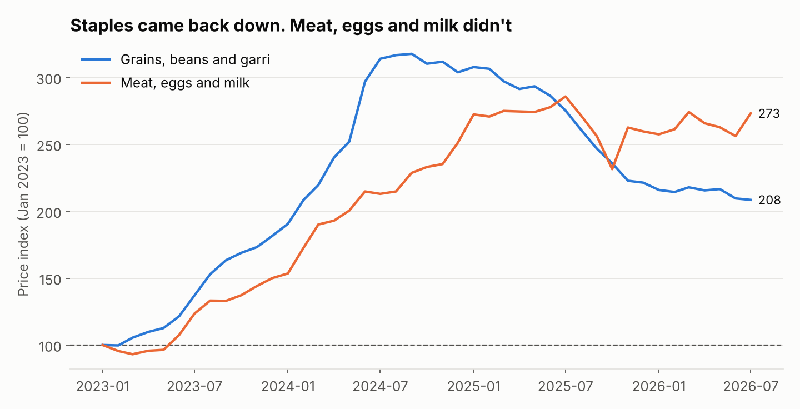
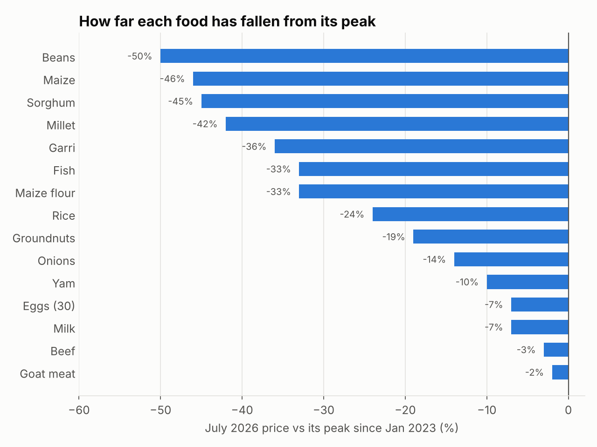
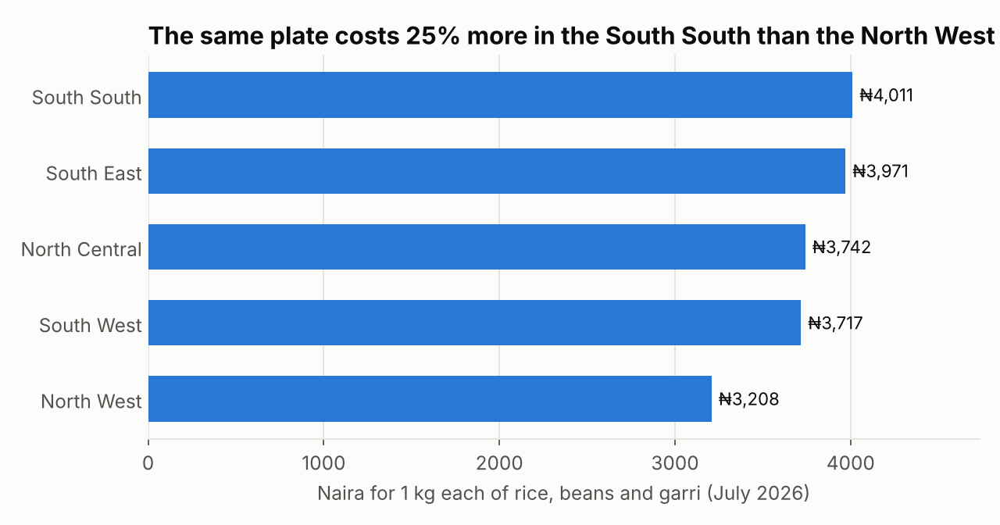

# Naira on the Plate

How food prices in Nigeria moved from 2019 to mid-2026: how high they went, what came back down, and where things cost the most right now.

**TL;DR:** food prices roughly **2.5x'd** between January 2023 and mid-2024, and year-on-year food inflation peaked at **112% in June 2024**. Since August 2025 prices have actually been falling compared to a year earlier. But not everything came down: grains and beans are about **35% below their peak**, while meat, eggs and milk are only **4% below** theirs. Right now the same basic plate (1 kg each of rice, beans and garri) costs **25% more in the South South than in the North West**.

Tools: Python (pandas, matplotlib)
Data: World Bank, [Monthly food price estimates by product and market, Nigeria](https://microdata.worldbank.org/catalog/4503), 66 markets, monthly, I used Jan 2019 to Jul 2026

## Why I looked at this

Food prices are what everyone around me has been talking about for the last two years. I wanted to see the actual numbers: how bad it got, whether it's really getting better, and whether it's the same everywhere in the country.

## About the data

This is the World Bank's Real-Time Food Prices dataset for Nigeria. It's built on market price data from WFP and FAO, then uses machine learning to fill in the months and markets where nobody collected a price. A few things I had to deal with:

- **Most of the prices are estimated, not observed.** Since 2019, only about 24% of the market-month prices were actually collected. The rest are the World Bank's model estimates. Before 2016 it's under 10% observed, which is why I start in 2019. I use the model's "close" price for everything, which is how the dataset is meant to be used, but it's worth knowing.
- **Some rows aren't real markets.** There's a "Market Average" row (the national series I use), five geopolitical zone rows (used for the regional comparison), and a row labelled "National Average" that's actually just the Abuja market. I kept those separate from the 66 real markets.
- **Units vary by food.** Beans are priced per 2.5 kg, eggs per 30, milk per 400 g, and so on. For the plate cost I converted everything to per kg.
- **Coverage leans north-east.** 53 of the 66 markets are in Borno, Yobe and Adamawa, probably because a lot of this monitoring is for humanitarian work there. Lagos, Oyo and Abia only have one market each, so I compare regions using the zone averages instead of single states.
- The file runs to August 2026, but the last month with survey data is July 2026, so August is dropped.

## What I found

### Food inflation went above 100%, then turned negative



Food prices were already rising 15-33% a year through 2021-2022. From mid-2023 it took off, and by June 2024 food was 112% more expensive than a year earlier. It cooled quickly through 2025 and went negative in August 2025, which means prices are now lower than a year ago (-4.9% in July 2026).

That doesn't mean food is cheap again though. The food price index in July 2026 is still 2.52 times what it was in January 2023.

### Staples came back down, protein didn't



I split the foods into two groups and indexed both to January 2023 = 100:

- **Grains, beans and garri** (beans, garri, maize, maize flour, millet, rice, sorghum) peaked at 318 in September 2024 and are now down to 208.
- **Meat, eggs and milk** (beef, goat meat, eggs, milk) peaked later, at 286 in July 2025, and are still at 273.



Beans are half what they were at their peak. Maize, sorghum and millet are down 42-46%. Beef and goat meat are only 2-3% below their peak. So for a household, the cheap calories have eased up, but protein is still about as expensive as it's ever been.

| Food | Jan 2023 | Peak | Peak month | Jul 2026 | Down from peak |
| --- | ---: | ---: | --- | ---: | ---: |
| Beans (2.5 kg) | ₦1,078 | ₦4,597 | Sep 2024 | ₦2,277 | -50% |
| Maize (1 kg) | ₦425 | ₦1,524 | Jul 2025 | ₦830 | -46% |
| Garri (1 kg) | ₦342 | ₦1,300 | Mar 2025 | ₦827 | -36% |
| Rice (1 kg) | ₦832 | ₦2,879 | Mar 2025 | ₦2,200 | -24% |
| Yam (2.5 kg) | ₦852 | ₦3,157 | Mar 2025 | ₦2,849 | -10% |
| Eggs (30) | ₦2,068 | ₦6,452 | Jul 2025 | ₦5,987 | -7% |
| Beef (1 kg) | ₦1,970 | ₦6,535 | Jul 2025 | ₦6,361 | -3% |

All 16 foods are in [`outputs/commodity_change.csv`](outputs/commodity_change.csv).

### Where it costs the most



To compare regions with one number, I added up the price of 1 kg each of rice, beans and garri. In July 2026 that plate costs ₦4,011 in the South South and ₦3,971 in the South East, compared to ₦3,208 in the North West. That's 25% more.

It wasn't always like that. At the peak in March 2025, the North West was actually the most expensive zone at ₦5,449. Since then it's dropped 41%, while the South South only dropped 24%. My guess is that's because most of these grains are grown in the north, so the north felt the drop first and it hasn't fully reached the south yet. The data can't prove that though.

| Zone | Jan 2023 | Mar 2025 (peak) | Jul 2026 |
| --- | ---: | ---: | ---: |
| South South | ₦1,611 | ₦5,300 | ₦4,011 |
| South East | ₦1,700 | ₦5,411 | ₦3,971 |
| North Central | ₦1,427 | ₦5,219 | ₦3,742 |
| South West | ₦1,491 | ₦4,817 | ₦3,717 |
| North West | ₦1,440 | ₦5,449 | ₦3,208 |

State-level numbers are in [`outputs/plate_by_state.csv`](outputs/plate_by_state.csv), but most states only have one or two markets, so I wouldn't read too much into them.

## What this means

- **Food inflation is over, but the price level isn't going back.** Prices are falling slowly, from a level 2.5x higher than early 2023.
- **Protein is the real problem now.** If you're thinking about nutrition, the fact that grains got cheaper while meat, eggs and milk stayed near their peak is the bigger story than the headline inflation number.
- **The south is lagging behind.** Prices fell faster where the food is grown. Whatever slows that down (transport, middlemen, storage) is worth looking into.

## Limitations

- Around three quarters of the prices since 2019 are model estimates, not collected prices. The trends are probably solid, but individual market-month numbers are less certain.
- The markets are heavily weighted toward the north-east, so the national average leans that way too.
- I didn't explain *why* prices moved. The rise lines up with the 2023 fuel subsidy removal and the naira devaluation, but this data alone can't prove cause and effect.
- The World Bank keeps revising these estimates as new prices come in. I used the version downloaded on 3 Aug 2026, so a newer download might give slightly different numbers.

## Running it yourself

1. Download the CSV from the [World Bank Microdata Library](https://microdata.worldbank.org/catalog/4503) (free account needed) and put it in `data/raw/`. The file is named like `NGA_RTFP_mkt_2007_YYYY-MM-DD.csv`.
2. Then:

```bash
pip install -r requirements.txt
python src/analyze.py
```

Every number in this README comes from the files in [`outputs/`](outputs/).
