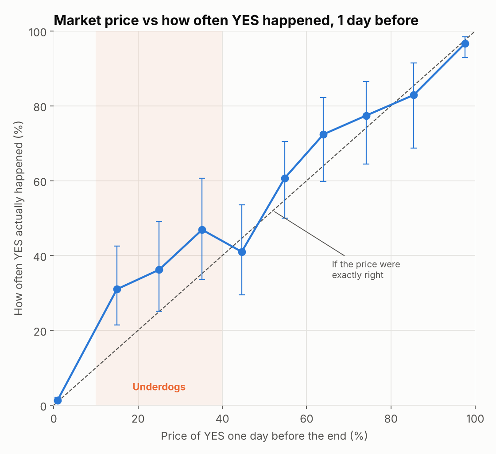
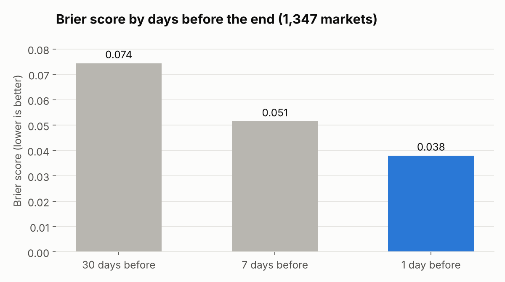
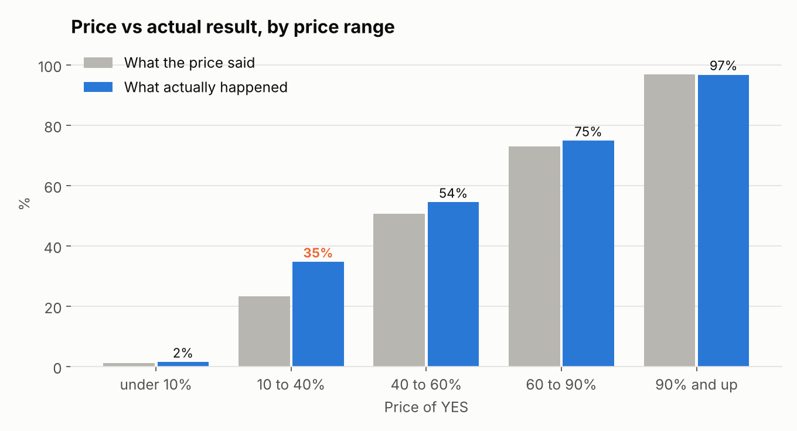
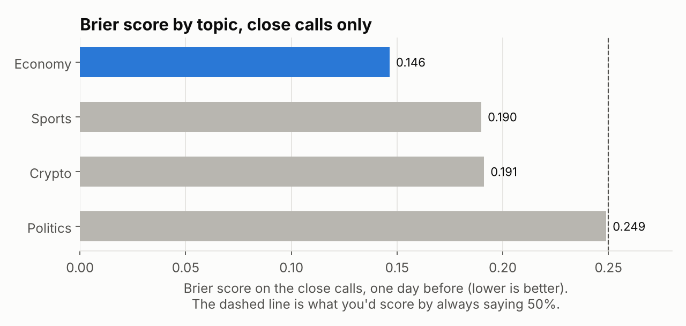

# Do Prediction Markets Know?

On Polymarket, people bet real money on elections, football matches, crypto prices and the Fed. The price works like a forecast. If "yes" costs 70 cents, the crowd is saying there's a 70% chance it happens.

So when the crowd says 70%, does it happen about 70% of the time?

I've built trading bots for these markets, so I've always wanted to know how much to trust the price.

**The short version:**

- **Mostly, yes.** Across 1,890 settled markets, the prices were close to what actually happened.
- **The crowd gets sharper as the end gets closer.** On the same 1,347 markets, the error score fell from **0.074** a month out to **0.038** the day before.
- **But it underrates underdogs.** Bets priced between 10% and 40% came true **35%** of the time, when the price said about **23%**.
- **Economy markets are the most accurate. Politics is the least.** On the genuinely close calls, politics markets did barely better than saying 50% every time.
- **More money didn't mean better forecasts.** The bigger markets were slightly *less* accurate, probably because they're about harder questions.

**Tools:** SQL (MySQL), Python (requests, pandas, matplotlib)
**Data:** Polymarket's public APIs, no key needed. The 500 biggest settled Yes/No markets in each of four topics: economy, crypto, sports and politics.

## How I scored the crowd

For each market I took the price of "yes" at three points: 30 days, 7 days and 1 day before it ended. Then I checked what actually happened.

Two ways to check:

1. **Group the prices into buckets** (0 to 10%, 10 to 20%, and so on) and see how often "yes" came true in each. If the crowd is honest, things priced at 70% should happen about 70% of the time.
2. **The Brier score.** For each forecast, take the gap between the price and what happened (1 or 0) and square it. Then average. 0 is perfect. Saying 50% every time scores 0.25, so anything lower beats a coin flip.

## What I found

### The crowd is mostly right



The dots should sit on the dashed line, and most of them do. Things priced at 90% and up happened 97% of the time. Things priced under 10% happened about 1% of the time.

Two in three forecasts were under 10%. That's because many Polymarket questions come in groups, like "Will X be the next Prime Minister?" for ten different people. Most of those people have no real chance, and the crowd knows it.

### It gets sharper close to the end



I only compared markets that were open for all three dates, so each bar scores the exact same 1,347 questions. A month out, the score is 0.074. The day before, it's 0.038, about half.

### But it underrates underdogs



| Price of YES | Forecasts | Price said | Actually happened |
| --- | ---: | ---: | ---: |
| Under 10% | 3,241 | 1.2% | 1.5% |
| **10 to 40%** | **593** | **23.3%** | **34.7%** |
| 40 to 60% | 345 | 50.6% | 54.5% |
| 60 to 90% | 398 | 73.1% | 74.9% |
| 90% and up | 317 | 96.9% | 96.8% |

This is the most useful finding. When the crowd says "probably not, about 1 in 4", it actually happened about 1 in 3 times.

Could that just be luck? The 593 forecasts above include the same market at different dates, so I checked the day-before prices on their own: 178 different markets, priced at 24% on average, and 37% of them came true. If the prices were right, a gap that big would happen by chance about 1 time in 10,000.

People are often told that bettors overpay for long shots. In this data it's the other way round, at least for the 10 to 40% range.

### Some topics are easier than others



Scoring every market makes everything look great, because so many are easy calls at 1% or 99%. So this chart only scores the close calls, priced between 5% and 95% the day before.

Economy markets (Fed decisions, inflation numbers, company sizes) did best. Politics did worst, at 0.249 against 0.25 for a coin flip. Wars, ceasefires and leaders leaving office are hard to call, even with millions of dollars on them.

### The biggest upsets

The full list is in [`upsets.csv`](outputs/upsets.csv). A few from the day before the end:

- "Iran x Israel/US conflict ends by April 7?" was priced at **0.7%**. It happened.
- "Government shutdown on Saturday?" was priced at **96.5%**. It didn't happen.
- "Will the price of Bitcoin be above $84,000 on January 30?" was at **96.7%**. It wasn't.

## What it means

- **Trust the price, but not blindly.** Overall it's a good forecast, and much better than a month earlier.
- **Underdogs at 10 to 40% are the place to look.** In this data they came true more often than the price said. If that holds, they're underpriced.
- **Be careful with politics.** The close political calls were barely better than a guess.

## How I did it

1. Downloaded the 500 biggest settled Yes/No markets for each topic and their full price histories ([`fetch.py`](src/fetch.py))
2. Built one row per market per date, with the price bucket and the squared error ([`01_staging.sql`](sql/01_staging.sql))
3. How often "yes" happened in each price bucket, with a 95% range ([`02`](sql/02_calibration.sql))
4. Brier score by how far out, on the same markets ([`03`](sql/03_score_by_horizon.sql))
5. Brier score by topic and by market size ([`04`](sql/04_score_by_topic.sql), [`06`](sql/06_score_by_volume.sql))
6. The underdog check ([`05`](sql/05_underdogs.sql)) and the biggest upsets ([`07`](sql/07_upsets.sql))

### Cleaning decisions

- **Only clean results.** I kept markets that settled at exactly 1 and 0, and dropped anything refunded at 50/50.
- **Each market counted once.** A Fed market can be tagged both "economy" and "politics". I went through the topics from most specific to least, so it only lands in economy.
- **The end is the earlier of two dates.** Some markets close early because the answer is already known. Using the planned end date would mean "1 day before" is really after the answer came out.
- **No price, no row.** If a market didn't exist yet 30 days before it ended, it has no 30-day forecast. That's why I compare horizons only on markets with all three.
- **The final settlement point is removed from the price history.** It's the answer, not a forecast.

## What this can't tell you

- **It's the biggest markets, not all of them.** Smaller markets might behave differently.
- **Topics overlap.** Tags are set by Polymarket, and some markets could fit in more than one.
- **Prices are taken twice a day.** The "1 day before" price can be up to 12 hours off.
- **The underdog finding is one period of data.** It covers markets that ended between January 2024 and October 2026. It's worth checking again before betting on it.

## Run it yourself

You need MySQL 8 running. Each project creates its own database and loads the raw data into it. If you don't log in as `root` with no password, set `MYSQL_USER` and `MYSQL_PASSWORD` first (and `MYSQL_HOST` if it isn't on your machine).

```bash
pip install -r requirements.txt
python src/fetch.py --per-tag 500   # about 30 minutes the first time, then it's cached
python src/run_analysis.py
```

Every number in this write-up comes from the files in [`outputs/`](outputs/).
