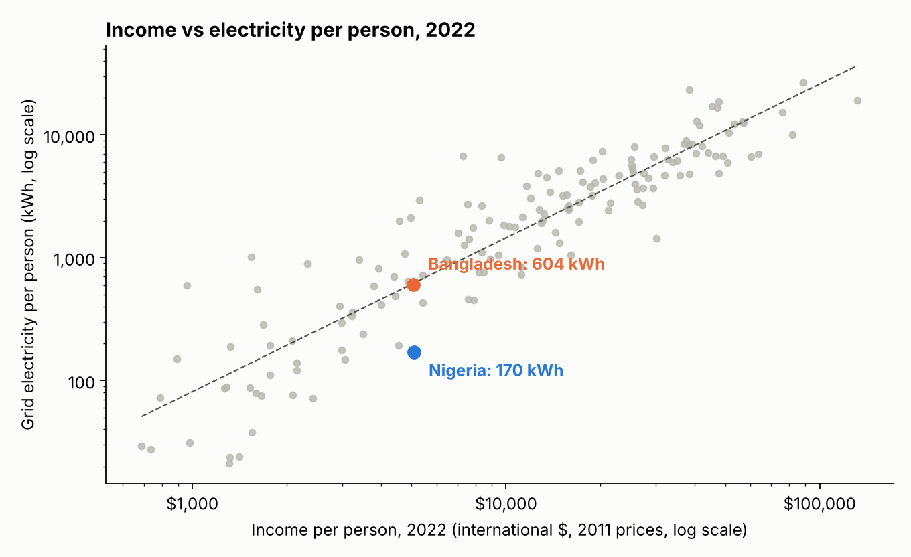
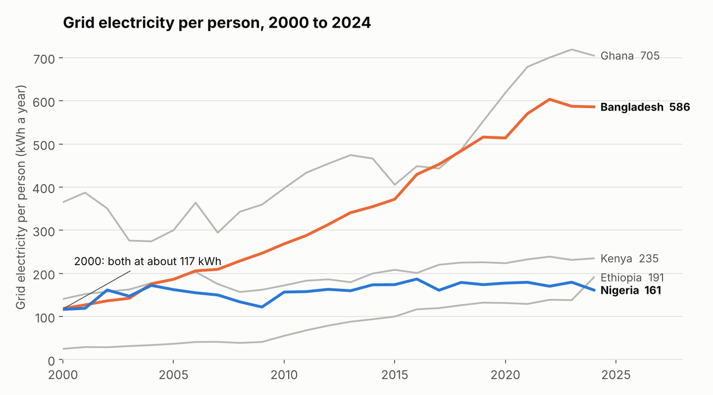
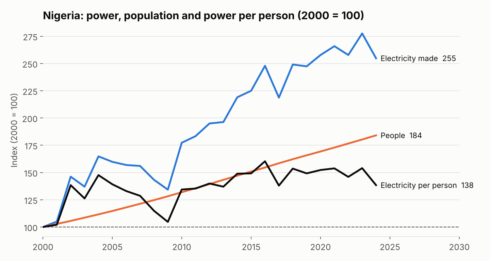
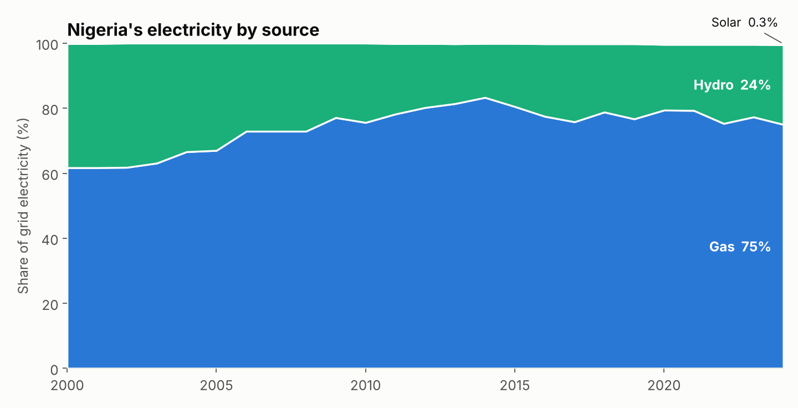
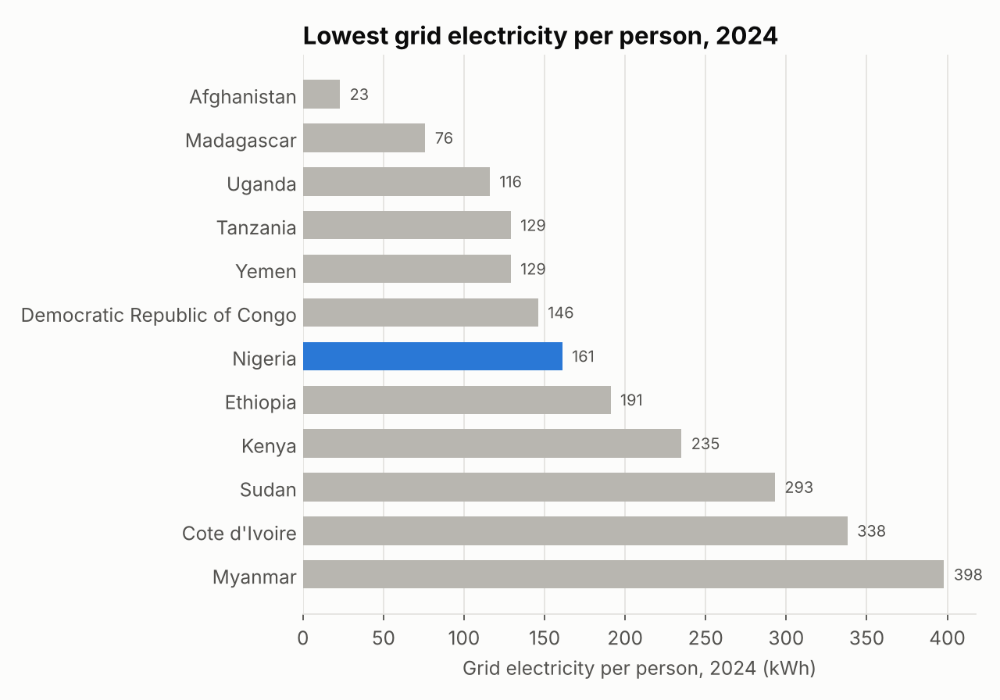

# Electricity in Nigeria compared with similar countries

In 2000, the average person in Nigeria and the average person in Bangladesh got about the same amount of electricity from the national grid, about **117 kWh** a year. By 2024, someone in Bangladesh got **586 kWh** and someone in Nigeria got **161**.

I wanted to know why, and whether it's just because Nigeria is poorer.

**Summary:**

- Since 2000, grid electricity per person grew **about 5x** in Bangladesh and **1.4x** in Nigeria.
- Ethiopia started at a fifth of Nigeria's level and is now ahead of it.
- Nigeria makes about **2.5x** more power than in 2000, but its population grew **1.8x**, so each person only gets a little more.
- Countries with Nigeria's income usually make about **620 kWh** per person. Nigeria makes about **a quarter of that**, the 6th lowest of 154 countries.
- In 2024, among the 49 countries with over 30 million people, only 6 had less grid power per person than Nigeria.

**Tools:** SQL (MySQL), Python (pandas, matplotlib), Jupyter
**Data:** [Our World in Data energy dataset](https://github.com/owid/energy-data), which draws on Ember and the Energy Institute. 220 countries, 2000 to 2024.

## Exploring the data first

This project started with an exploration notebook, [`notebooks/explore.ipynb`](notebooks/explore.ipynb), before I knew what question I wanted to answer. I looked at what a row means, how far back Nigeria's data goes, how complete each year is, and where Nigeria sits among all countries.

That's where the best finding came from:



Richer countries use more electricity, so a low number alone doesn't prove much. The fair question is whether Nigeria gets less than **countries with a similar income**.

In 2022, Nigeria and Bangladesh had almost the same income per person (about $5,080 in 2011 prices). Bangladesh gets close to what a country of its income usually gets. Nigeria gets **27%** of it. Only five countries out of 154 are further below the line.

## What I found

### Nigeria and Bangladesh, 2000 to 2024



| Country | kWh per person, 2000 | kWh per person, 2024 | Growth |
| --- | ---: | ---: | ---: |
| Nigeria | 117 | 161 | 1.4% a year |
| Ethiopia | 25 | 191 | 8.8% a year |
| Kenya | 141 | 235 | 2.2% a year |
| Bangladesh | 118 | 586 | 6.9% a year |
| Ghana | 365 | 705 | 2.8% a year |
| Vietnam | 344 | 3,006 | 9.4% a year |

On average, Bangladesh grew its electricity per person by about 7% a year for 24 years. Nigeria managed 1.4%. Vietnam isn't on the chart because it would squash everything else: it went from about three times Nigeria's level to almost **19 times**.

### Power supply vs population growth



Nigeria isn't standing still. It made **2.5 times** as much grid electricity in 2024 as in 2000. But there are also **1.8 times** as many Nigerians, so electricity per person only rose by about **38%** in 24 years.

And it doesn't rise smoothly. Generation fell in 10 of those 24 years: 2003, every year from 2005 to 2009, and in 2017, 2019, 2022 and 2024.

### Sources of Nigeria's electricity



About **three quarters** of Nigeria's grid power comes from gas and a quarter from hydro. Solar is **0.3%**, in a country that is not short of sun.

Nigeria also **sells** some of its power. Since 2016 it has exported about **7%** of what it makes each year. So Nigerians use even less than the per-person number suggests.

### Nigeria's rank among large countries



Among the 49 countries with 30 million people or more, Nigeria ranks **7th from the bottom**. The countries below it include Afghanistan, Yemen and the DR Congo.

## What it means

- **Being poor doesn't explain it.** Bangladesh had the same income and the same starting point, and it now makes 3.6 times as much power per person. Whatever is holding Nigeria back, it isn't just money.
- **Growth has to beat population growth.** Making 2.5x more power sounds good until you divide it by 1.8x more people. To actually move the per-person number, generation has to grow much faster than it has.
- **Solar is the obvious gap.** At 0.3% of the grid, there is a lot of room.

I didn't try to explain *why* Nigeria fell behind. That would need data on investment, gas supply, grid losses and policy, which this dataset doesn't have.

## Cleaning the data

Here's every step with the rows left after it. The counts come straight from [`08_cleaning_log.sql`](sql/08_cleaning_log.sql) and are saved in [`outputs/cleaning_log.csv`](outputs/cleaning_log.csv). One row is one country or region in one year.

| Step | What I did | Rows after | Why |
| ---: | --- | ---: | --- |
| 1 | Started with the raw file | 23,377 | 314 countries and regions, 1900 to 2025, 130 columns |
| 2 | Dropped regions, kept countries | 17,265 | Rows like "Africa" or "World" are totals, so keeping them would count people twice. 220 countries left |
| 3 | Kept 2000 to 2024 | 5,459 | Nigeria's data starts in 2000. 2025 only covers 90 countries so far, against 196 for 2024 |
| 4 | Checked for duplicate country-years | 5,459 | Found none |
| 5 | Checked for gaps | 5,459 | Nigeria has all 25 years. 162 other country-years are empty, almost all small territories, plus 2 years for Ukraine. Left empty, not guessed |
| 6 | Checked the per-person maths | 5,459 | kWh per person matches generation divided by population, to within 0.001 kWh |
| 7 | Checked why use and generation differ | 5,459 | From 2016, the gap matches Nigeria's exports exactly, so it's power sold abroad, not an error |
| 8 | Noted what the data can't see | 5,459 | Grid power only. Home and business generators aren't counted |

## How I did it

1. Explored the data first in a notebook ([`explore.ipynb`](notebooks/explore.ipynb))
2. Built one clean row per country per year in SQL ([`01_staging.sql`](sql/01_staging.sql))
3. Electricity per person for Nigeria and its peers ([`02`](sql/02_per_person.sql))
4. Where each country started and ended, and its yearly growth rate ([`03`](sql/03_then_and_now.sql))
5. Generation vs population, both indexed to 2000 ([`04`](sql/04_more_power_more_people.sql))
6. Nigeria's power mix and exports ([`05`](sql/05_power_mix.sql), [`06`](sql/06_power_sold_abroad.sql))
7. Nigeria's rank among large countries ([`07`](sql/07_world_rank.sql))
8. The cleaning log ([`08`](sql/08_cleaning_log.sql))

## What this can't tell you

- **It's grid electricity only.** Millions of Nigerian homes and businesses run their own generators, and none of that is counted. Real electricity use is higher than these numbers. But it's also much more expensive, which is the point.
- **It measures power made, not power that reaches people.** Electricity lost on the way through the grid isn't separated out.
- **The income comparison is a simple line through all countries.** It's a fair first look, not a full model.
- **It doesn't explain the why.** It shows how far behind Nigeria is, not what caused it.

## Run it yourself

You need MySQL 8 running. Each project creates its own database and loads the raw data into it. If you don't log in as `root` with no password, set `MYSQL_USER` and `MYSQL_PASSWORD` first (and `MYSQL_HOST` if it isn't on your machine).

```bash
pip install -r requirements.txt
bash src/get_data.sh
python src/run_analysis.py
jupyter nbconvert --to notebook --execute notebooks/explore.ipynb   # the exploration
```

Every number in this write-up comes from the files in [`outputs/`](outputs/) or the notebook.
