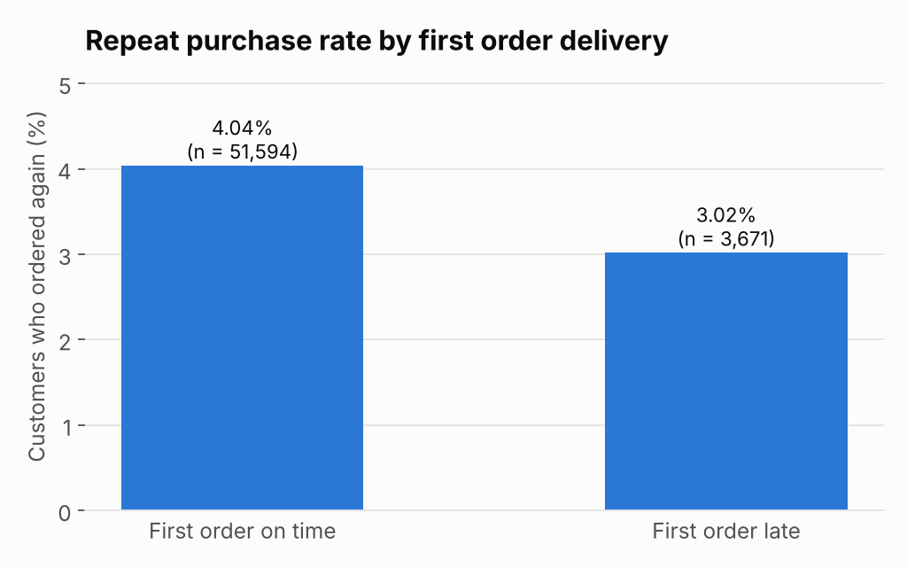
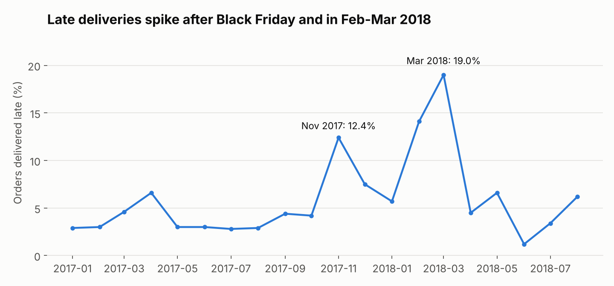
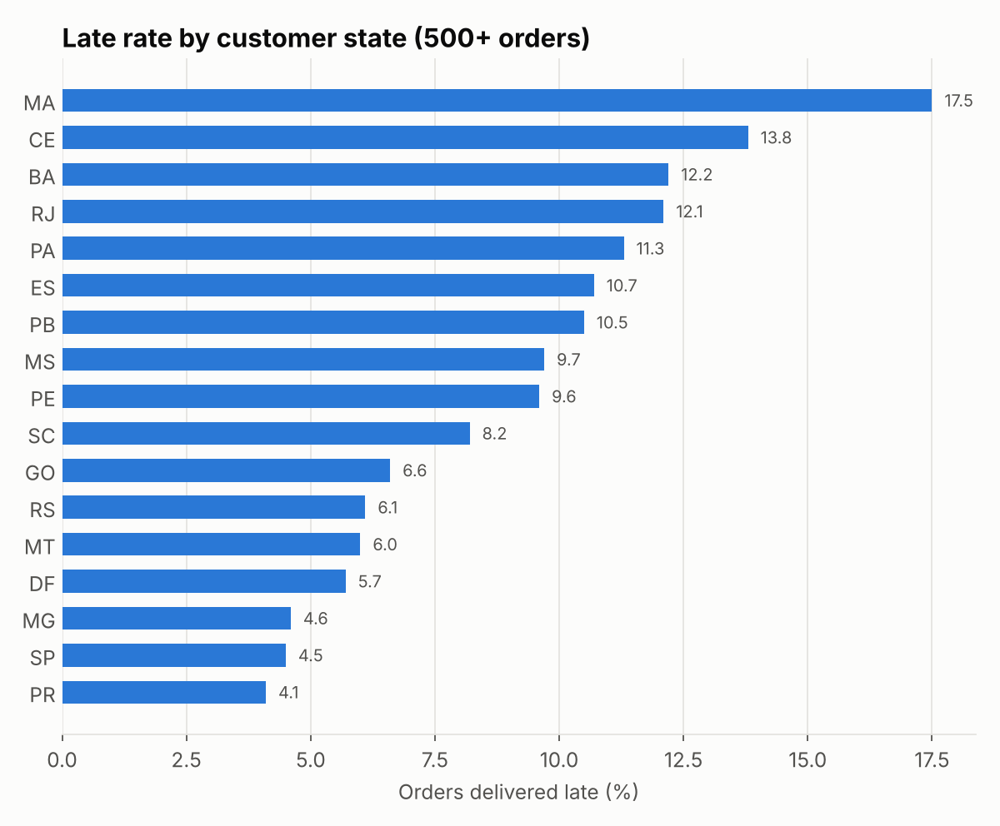
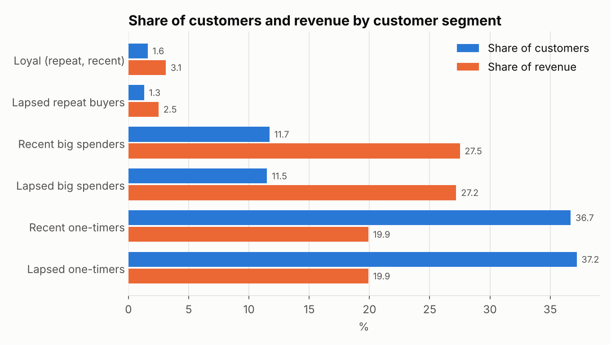

# Late Parcels, Low Stars

We've all waited on a parcel that said "arriving today" and didn't. You check the tracking, you check it again, and by the time it shows up you're not in a generous mood.

I wanted to know what that moment costs the store. So I went through **96,203** orders from Olist, a Brazilian online marketplace, and asked three things: how much does a late delivery hurt the review, does it cost the next sale too, and where do late deliveries come from?

**The short version:**

- On-time orders average **4.28** stars. Late ones average **2.26**.
- First-time buyers whose order came late were **25% less likely** to order again.
- The problem is concentrated. Just **98 of 2,945** sellers cause half of all late orders.

**Tools:** SQL (MySQL), Python (pandas, SciPy, matplotlib)
**Data:** [Olist Brazilian E-Commerce dataset](https://www.kaggle.com/datasets/olistbr/brazilian-ecommerce), 96,203 delivered orders from January 2017 to August 2018

## What I found

### People forgive a lot, but not lateness


| Delivered | Orders | Avg review | 1-2 star reviews | 5 star reviews |
| --- | ---: | ---: | ---: | ---: |
| On time or early | 89,672 | 4.28 | 9.5% | 62.0% |
| 1-3 days late | 1,869 | 3.28 | 32.4% | 33.1% |
| 4-7 days late | 1,802 | 2.09 | 68.1% | 13.7% |
| 8-14 days late | 1,478 | 1.67 | 80.4% | 6.8% |
| 15+ days late | 1,382 | 1.72 | 78.5% | 7.1% |

It doesn't take much. Even one to three days late more than triples the share of 1 and 2 star reviews. Once an order is more than a week late, about 4 in 5 reviews are 1 or 2 stars.

To make sure this wasn't luck, I ran a Mann-Whitney U test on the review scores. The gap between on-time and late orders is real (p < 0.001) and large (rank-biserial correlation of 0.64).

### A late first order costs the next sale too



I looked at customers whose first order was before March 2018, so everyone had at least six months to come back. When the first order arrived on time, 4.04% of them ordered again. When it was late, only 3.02% did. That's about 25% fewer comebacks (chi-square = 9.1, p = 0.003).

Not many people order twice on Olist anyway, so these are small numbers. But the cost stacks up: a late order loses you the good review and makes the next order less likely.

### Late orders come from a few places



- **When:** in a normal month, about 3 to 4% of orders are late. After Black Friday in November 2017 that jumped to 12.4%. It calmed down in January, then spiked again in February 2018 (14.1%) and March 2018 (19.0%) before going back to normal in April.
- **Where:** Rio de Janeiro has 12.8% of all orders but 22.9% of the late ones. Its late rate (12.1%) is 2.7x São Paulo's (4.5%). The Northeast has it worst, with Maranhão at 17.5%.
- **Who:** 98 of 2,945 sellers (3.3%) cause half of all late orders. The full list is in [`outputs/05_seller_late_rates.csv`](outputs/05_seller_late_rates.csv).



### A small group brings in most of the money



The top quarter of customers by spend make up 23% of customers but bring in 55% of the revenue. Only 2.9% of customers have ever ordered more than once, so there isn't really a loyal crowd to protect yet. The bigger win is getting a second order out of people who spent big the first time.

## What I'd do

The good news is that this is a small, findable problem, not a broken delivery network.

1. **Get the first order right.** Promise first-time buyers a date two or three days later than usual, one you know you can hit. A slightly longer wait costs less than a 1-star review and a customer who never comes back.
2. **Watch the worst sellers.** About 100 sellers cause half the late orders. A monthly on-time scorecard for them would do more than trying to fix everyone.
3. **Plan for the busy months.** Give Rio and the Northeast more realistic dates, and pad them around Black Friday and February to March, instead of promising the same timeline everywhere.

What I'd test next: whether a padded delivery date actually lifts reviews (an A/B test on the promise), and how much money those lost repeat orders are worth.

## How I did it

The dataset has 9 tables. I used four: orders (dates and status), reviews (1 to 5 stars), customers (their state, plus an ID that follows one person across orders) and order items (which seller shipped what).

1. Built one clean row per order in SQL ([`01_staging.sql`](sql/01_staging.sql))
2. Grouped orders by how late they were and compared reviews ([`02`](sql/02_delivery_vs_reviews.sql))
3. Looked at late rates by month, by state and by seller ([`03`](sql/03_late_rate_by_month.sql), [`04`](sql/04_late_rate_by_state.sql), [`05`](sql/05_seller_late_rates.sql))
4. Compared how often customers came back after a late vs on-time first order ([`06`](sql/06_repeat_purchase.sql))
5. Split customers by how recently, how often and how much they buy (RFM) to see who brings in the money ([`07`](sql/07_rfm_segments.sql))
6. Ran the significance tests in Python ([`run_analysis.py`](src/run_analysis.py))

A few choices worth knowing about:

- I only kept **delivered** orders placed from January 2017 to August 2018. The months outside that range only have a handful of orders.
- An order counts as **late** if it arrived on a later day than the date promised at checkout.
- Some orders have more than one review, so I kept the latest one.

## What this can't tell you

- The data only includes orders that were eventually delivered. Anything still on its way when the data was pulled is missing, so the last few months probably look better than they were.
- The repeat purchase result shows a link, not proof that lateness caused it. Customers who got late orders might be different in other ways, like where they live.
- If one order had items from several sellers, it counts toward each of them in the seller numbers.

## Run it yourself

You need MySQL 8 running. Each project creates its own database and loads the raw data into it. If you don't log in as `root` with no password, set `MYSQL_USER` and `MYSQL_PASSWORD` first (and `MYSQL_HOST` if it isn't on your machine).

```bash
pip install -r requirements.txt
bash src/get_data.sh
python src/run_analysis.py
```

Every number above comes from the files in [`outputs/`](outputs/). [`summary.json`](outputs/summary.json) has the headline numbers and test results.
