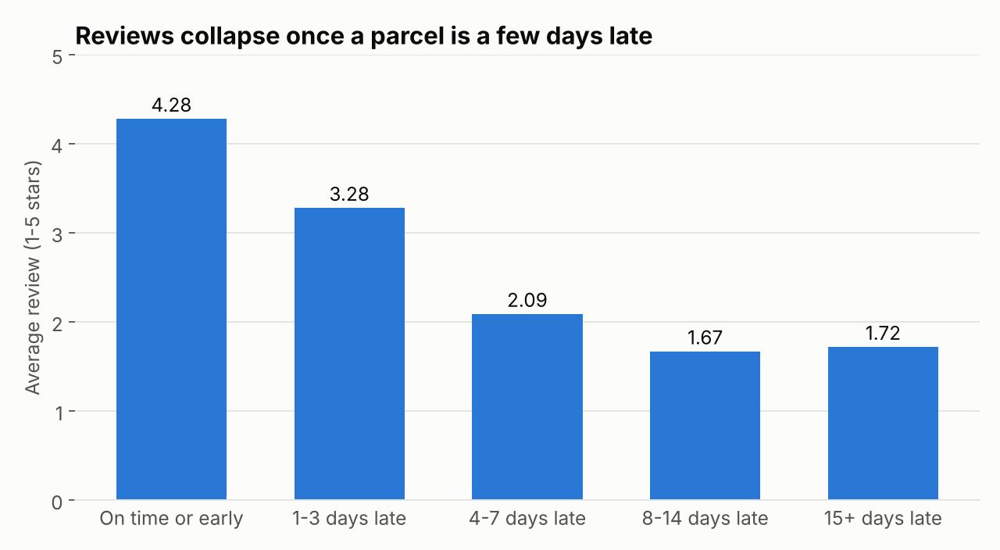

# data-analyst-portfolio

Hi, I'm Olamide Okunola. Most people call me Mide, and online I'm midexol pretty much everywhere. I study Computer Science at FUTA in Akure, Nigeria, and I'm looking for my first analyst internship.

I like questions people actually argue about. Is food really getting cheaper? Why do customers stop coming back? Everyone has an opinion, so I'd rather go and count. Every project here uses public data, which means you can rerun my work and check every number yourself.

## Projects

| Project | The question | Tools | Status |
| --- | --- | --- | --- |
| [Naira on the Plate](01-nigeria-food-prices/) | Food prices in Nigeria went wild. What came back down, and what didn't? | SQL, Excel, Python | Done |
| [Late Parcels, Low Stars](04-olist-delivery-reviews/) | What does a late delivery really cost an online store? | SQL, Python | Done |
| [Do Prediction Markets Know?](02-polymarket-calibration/) | When Polymarket says 70%, does it happen 70% of the time? | Python | Code ready, not run yet |
| [Remittance Rails](03-stellar-remittance/) | How much money moves on Stellar, and who's sending it? | BigQuery SQL | Queries ready, not run yet |

## The finished ones

### Naira on the Plate

In January 2023, a 2.5 kg bag of beans cost about ₦1,078. By September 2024 it was ₦4,597. I used the World Bank's price data for 66 Nigerian markets to see the whole story.

At the worst point, in June 2024, food prices were rising 112% a year. Since August 2025 they've been falling, but they're still about 2.5x what they were in early 2023. And the fall isn't even. Staples like rice, beans and garri are about 35% off their peak. Meat, eggs and milk are only 4% off theirs.

[Read the full story](01-nigeria-food-prices/), or open the [Excel version](01-nigeria-food-prices/excel/naira_on_the_plate.xlsx) and pick any food to see its price since 2019.

### Late Parcels, Low Stars

We've all waited on a parcel that said "arriving today" and didn't. I went through 96,203 orders from Olist, a Brazilian marketplace, to see what that costs the store.

On-time orders average 4.28 stars. Late ones average 2.26. First-time buyers whose order came late were 25% less likely to order again. The good news is the problem is easy to find: just 98 of 2,945 sellers cause half of all late orders.

[Read the full story](04-olist-delivery-reviews/).

## How each project is laid out

- `README.md` is the write-up
- `sql/` has the queries, numbered in the order they run
- `src/` has the scripts that download the data and run everything
- `outputs/` has the result tables. Every number in a write-up comes from here
- `charts/` has the charts

Raw data isn't saved in the repo. Each project tells you where to get it.

## Say hi

Email is the fastest way to reach me: okunolaolamide7@gmail.com
